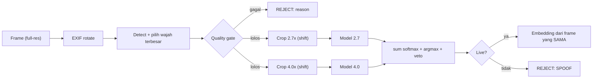

# Plan Perbaikan Anti-Spoofing (Kananonik)

> Dokumen ini menggabungkan dan **menggantikan** dua dokumen sebelumnya:
> `plan.md` (versi lama) dan `Analisis Repo capacitor-face-recognition-tflite dan Dampaknya ke Plan Anti-Spoof.md`.
> Analisis lama tetap disimpan sebagai arsip, tetapi semua hipotesisnya sudah diverifikasi ke kode — lihat "Status Verifikasi" di bawah. Penomoran fase yang berlaku **hanya** yang di dokumen ini.

Tujuan: menutup celah replay/print attack di [FaceRecognitionPlugin.java](../android/src/main/java/com/andrew/face/FaceRecognitionPlugin.java) dan [FaceRecognitionPlugin.swift](../ios/Sources/FaceRecognitionPlugin/FaceRecognitionPlugin.swift). Pipeline dibuat sama persis dengan implementasi referensi (Silent-Face / shubham0204), lalu ditambah lapisan pertahanan.



---

## Status Verifikasi (klaim analisis lama vs kode aktual)

Dilakukan dengan membaca kode di repo ini. Baris berdampak langsung ke prioritas.

| # | Klaim (analisis lama) | Fakta di kode | Status |
|---|---|---|---|
| 1 | Bug indeks label: `score[0]` dianggap live | Android sudah memakai `probs[1]` (`// Index 1 = Wajah Asli`), [FaceRecognitionPlugin.java:492](../android/src/main/java/com/andrew/face/FaceRecognitionPlugin.java#L492). README-nya yang salah | ❌ Bantah |
| 2 | Preprocessing anti-spoof memakai normalisasi `[-1,1]` | Kedua platform sudah memakai **BGR mentah 0..255** (`bitmapToByteBufferAntiSpoof`, `imageToInputDataAntiSpoof`). Normalisasi `[-1,1]` hanya untuk MobileFaceNet — memang benar begitu | ❌ Bantah |
| 3 | `ANTI_SPOOF_SCALES = {1.0f, 2.7f}` masih dipakai | Terkonfirmasi, [FaceRecognitionPlugin.java:61](../android/src/main/java/com/andrew/face/FaceRecognitionPlugin.java#L61) | ✅ Benar |
| 4 | Crop memakai square + clip, bukan shift referensi | Terkonfirmasi: `side = max(w,h)` lalu `Math.max(0,…)`/`Math.min(…)`, [.java:455-470](../android/src/main/java/com/andrew/face/FaceRecognitionPlugin.java#L455) | ✅ Benar — **akar masalah utama** |
| 5 | Keputusan memakai rata-rata skor live antar scale | Terkonfirmasi: `scoreSum / scaleCount`, tanpa argmax 3-kelas, tanpa veto spoof, [.java:390-404](../android/src/main/java/com/andrew/face/FaceRecognitionPlugin.java#L390) | ✅ Benar |
| 6 | Bug compile `landmarksRequest` (iOS L345) | Terkonfirmasi: variabel dipakai tanpa definisi → iOS tidak dapat compile | ✅ Benar |
| 7 | `embeddingSize` iOS = 128, output aktual 192 | Terkonfirmasi 128, [.swift:29](../ios/Sources/FaceRecognitionPlugin/FaceRecognitionPlugin.swift#L29). Angka 192 perlu dibuktikan ke model | ✅ Sebagian |
| 8 | Web stub bisa mengembalikan `isLive: true` | `web.ts` mengembalikan `{isLive: false, score: 0}` — sudah fail-closed | ❌ Bantah |
| 9 | Threshold tidak konsisten (0.75 / 0.5 / 0.6) | Terkonfirmasi: hardcode `0.75` di Java, Swift, dan `compareFaceFeature` web.ts | ✅ Benar |
| 10 | `detectFaces` tidak mengembalikan pitch | Terkonfirmasi: hanya `headEulerAngleY` dan `Z` | ✅ Benar |
| 11 | Model ~5,7 MB mencurigakan (bukan bobot referensi) | **Terbukti identik** dengan `spoof_model_scale_2_7.tflite` referensi (SHA-256 `5d573d20…49d4dd`, 5.979.004 bytes). Ukuran 5,7 MB memang ukuran file referensi | ✅ Bantah |

**Kesimpulan triage:** hipotesis "Hari 0" (indeks label + preprocessing) sudah selesai dibuktikan lewat kode dan keduanya bantah — termasuk identitas model yang kini terkonfirmasi bobot referensi asli. Akar masalah screenshot lolos tersisa di **logika crop (square + clip vs shift), scale 1.0 yang tidak ada di referensi, dan keputusan tanpa argmax/veto**. Semua ada di Fase 2.

---

## Fase 1: Hotfix terkonfirmasi (P0, 1–2 hari)

Perbaikan kecil yang sudah pasti benar, tidak menunggu apa pun.

1. iOS: ganti `landmarksRequest` menjadi `request` di [FaceRecognitionPlugin.swift:345](../ios/Sources/FaceRecognitionPlugin/FaceRecognitionPlugin.swift#L345) (compile error).
2. iOS: `embeddingSize` disesuaikan dengan output aktual model (192) — buktikan dengan `interpreter.output(at:0).shape` sebelum mengubah.
3. Satu sumber kebenaran threshold: konstanta per platform + field `thresholdVersion` di setiap hasil. Hapus angka 0.5/0.6 yang menyesatkan dari README.
4. Perbaiki komentar yang salah: `Index 0 = live`, `128x128`, `[spoof, live]` → urutan sebenarnya `[print_spoof, live, replay_spoof]`, input `80x80`.
5. Perbaiki README yang menulis `score[0] > 0.5` — kenyataannya `probs[1] > 0.75`. Tambah catatan bahwa `checkLiveness` versi lama tidak dapat dipercaya dan embedding yang pernah di-enroll perlu diaudit.
6. Rapikan duplikasi `leftEyeProb`/`rightEyeProb` di `detectFaces` Android.

**Kriteria selesai:** Android dan iOS build, README konsisten dengan kode.

> [!NOTE]
> `checkLiveness` dipertahankan namanya sebagai pembungkus pipeline baru, tetapi **semantik skornya berubah** (dari rata-rata skor live ke `liveScore` pasca-argmax). Ini bukan backward-compatible secara perilaku — cantumkan di changelog. Tidak ada gunanya mempertahankan perilaku lama yang hasilnya tidak bisa dipercaya.

---

## Fase 2: Pipeline referensi (P0–P1, 3–5 hari)

### 2.1 Prasyarat model — ✅ SELESAI

> [!NOTE]
> Kedua model sudah tersedia di repo (diambil langsung dari [shubham0204/OnDevice-Face-Recognition-Android](https://github.com/shubham0204/OnDevice-Face-Recognition-Android), `app/src/main/assets/`):
>
> | File referensi | SHA-256 | Status |
> |---|---|---|
> | `spoof_model_scale_2_7.tflite` | `5d573d20b795a19d7b2a0f67cc4c1130ce8ec30d5f6aa06b2c788a344a49d4dd` | Identik dengan `anti_spoof.tflite` yang ada — tidak perlu diganti |
> | `spoof_model_scale_4_0.tflite` | `32eecfa06cd0cf3c514276fb8521ed820fc256bacf4c616a1f05612d1c156463` | Sudah dipasang sebagai `anti_spoof_4_0.tflite` |
>
> Lokasi: `android/src/main/assets/` dan `ios/Sources/FaceRecognitionPlugin/Resources/`.

Saat implementasi Fase 2.2, rename `anti_spoof.tflite` → `anti_spoof_2_7.tflite` (sekalian memperbarui referensi nama file di Java/Swift) agar penamaan dua model simetris dengan `anti_spoof_4_0.tflite`.

### 2.2 Dua model, hapus scale 1.0
- Hapus `ANTI_SPOOF_SCALES = {1.0f, 2.7f}`.
- Dua interpreter: `antiSpoof27`, `antiSpoof40`, masing-masing dengan crop scale yang sesuai. Satu interpreter per model, dipakai `synchronized` (TFLite Interpreter tidak thread-safe).

### 2.3 Port crop referensi (`_get_new_box`)
Ganti `runAntiSpoofInference` di kedua platform:
```
scale = min((H-1)/box_h, (W-1)/box_w, scale)   // turunkan scale jika tak muat
new_w = box_w * scale ; new_h = box_h * scale   // w & h TERPISAH, tanpa square
lt = center - new/2 ; rb = center + new/2
if lt < 0: geser ke kanan/bawah                  // SHIFT, bukan clip
if rb > W-1/H-1: geser ke kiri/atas
crop → resize 80x80 → BGR float raw [0..255]
```
Bandingkan dengan implementasi sekarang: square-ifikasi `max(w,h)` + clip di batas gambar. Perbedaan inilah yang membuat konteks artefak (tepi layar/kertas) terpotong.

### 2.4 Logika keputusan
```
p = softmax(out27) + softmax(out40)        // rentang 0..2
label = argmax(p)
liveScore   = p[1] / 2
spoofScore  = max(p[0], p[2]) / 2
isLive = label == 1
      && liveScore  >= LIVE_THRESHOLD      // default 0.80, bisa dikonfigurasi
      && spoofScore <  SPOOF_VETO          // default 0.20
```
- Return `liveScore`, `printScore`, `replayScore`, dan `label` (`LIVE` | `PRINT` | `REPLAY`).
- Preprocessing tetap BGR mentah 0..255 (sudah benar — jangan diubah).

**Kriteria selesai:** golden test lolos (Fase 5.1) untuk kedua model, perilaku Android dan iOS sebanding pada sampel yang sama.

---

## Fase 3: Quality gate dan API terpadu (P1, 3–5 hari)

### 3.1 Quality gate

| Item | Implementasi | Default |
|---|---|---|
| EXIF | Android: `ExifInterface` lalu rotasi bitmap. iOS: normalisasi `imageOrientation` | — |
| Pilih wajah | Wajah dengan bbox terbesar; tolak jika > 1 wajah besar | — |
| Detector | ML Kit `PERFORMANCE_MODE_ACCURATE` untuk liveness | — |
| Resolusi frame | Sisi terpendek ≥ N px | 480 |
| Ukuran wajah | `faceWidth / frameWidth` ≥ min | 0.25 |
| Wajah di tepi | bbox tidak menyentuh tepi frame (margin) | 5% |
| Pose | \|yaw\|, \|pitch\| < batas, \|roll\| < batas | 20° |
| Blur | Variance of Laplacian pada crop wajah ≥ min | kalibrasi |
| Exposure | Mean luminance wajah dalam rentang | 60–200 |

Jika gate gagal: `isLive=false` + `reason` (`FACE_TOO_SMALL`, `FACE_AT_EDGE`, `BLURRY`, `MULTIPLE_FACES`, `BAD_POSE`, `BAD_LIGHTING`). Hasil ini **tidak dianggap live**, dan UI memberi instruksi ke user.

Prasyarat: tambahkan `headEulerAngleX` (pitch) ke `detectFaces` — sekarang hanya `Y` dan `Z`. Pisahkan gate pose frontal dari fase active challenge agar tidak bertabrakan.

### 3.2 API terpadu `verifyFace` (menutup TOCTOU)
```ts
verifyFace(options: {
  imageBase64: string;
  referenceEmbedding?: number[];   // jika ada → sekaligus compare
  config?: LivenessConfig;
}): Promise<{
  isLive: boolean;
  liveness: { label: 'LIVE'|'PRINT'|'REPLAY'; liveScore: number; printScore: number; replayScore: number };
  quality: { passed: boolean; reason?: QualityReason; faceRatio: number; blur: number };
  embedding?: number[];            // HANYA diisi jika isLive
  match?: { isMatch: boolean; score: number };
}>;
```
- Embedding **hanya** diekstrak dari frame dan bbox yang sama setelah lolos liveness. Kriteria selesai: tidak ada jalur kode yang mengembalikan embedding tanpa lolos liveness pada frame yang sama.
- `checkLiveness` tetap ada sebagai pembungkus (lihat catatan Fase 1).
- `LivenessConfig` berisi threshold yang bisa di-override untuk kalibrasi.
- Enrollment lebih ketat dari verifikasi harian: multi-frame, quality gate penuh, verifikasi server sebelum embedding diterima. Enrollment adalah titik paling kritis — embedding palsu yang masuk akan terus dianggap valid.

### 3.3 Multi-frame dan active challenge (helper di plugin)
> [!NOTE]
> **Keputusan terkunci:** active challenge dibuat sebagai helper di plugin (bukan hanya dokumentasi layer aplikasi).

- Helper baru di plugin, mis. `verifyFaceSequence(options)`: mengambil ≥ 5 frame dalam ~1,5 detik, mengeluarkan challenge acak (`LOOK_LEFT` / `LOOK_RIGHT`), dan memverifikasi respons lewat `headEulerAngleY` dari frame yang sama.
- Agregasi: jangan pakai aturan "semua frame harus live" — dengan BPCER per frame 10%, aturan itu dari 5 frame menghasilkan penolakan sesi ~41%. Pakai voting atau median `liveScore`.
- Identitas harus konsisten antar frame (cosine ≥ 0.8 terhadap frame pertama) agar wajah tidak ditukar di tengah sesi.
- Challenge memakai pose gate terpisah dari gate frontal (lihat Fase 3.1) agar keduanya tidak bertabrakan.
- Aplikasi tetap bisa memakai `verifyFace` tunggal untuk alur non-challenge.

### 3.4 Server-side (dibatasi oleh ketersediaan backend)
> [!NOTE]
> **Keputusan terkunci:** backend HRIS hanya menyediakan data vector image (penyimpanan/pengambilan embedding), bukan layanan verifikasi. Tidak ada infra nonce/signing/frame-audit di sisi server.
>
> Konsekuensi yang diterima:
> - Perbandingan embedding (match) dilakukan di perangkat memakai vector dari backend — hasil `match` tetap indikasi, bukan bukti.
> - Mitigasi: pertahanan bergeser ke sisi klien (Fase 3 dan 4) dan jejak audit lokal (frame + hasil disimpan di aplikasi, terenkripsi, untuk pemeriksaan fraud HRIS).
> - Jika kelak backend menyediakan endpoint verifikasi, tambahkan challenge-response nonce dan re-verifikasi server sebagai upgrade — lihat Fase 4.

---

## Fase 4: Pertahanan berlapis untuk HRIS (P2, 1–3 minggu)

Bagian yang paling menentukan ketahanan terhadap kecurangan nyata. Karena backend tidak menyediakan layanan verifikasi (lihat Fase 3.4), pertahanan difokuskan ke sisi klien dan aplikasi.

- Capture dilakukan native di dalam plugin (CameraX / AVFoundation), bukan menerima gambar dari JS — mempersempit celah injeksi frame.
- Deteksi root, emulator, dan hook (client-side). Device attestation (Play Integrity / App Attest) bisa dibaca di klien sebagai sinyal, dengan catatan: verdict yang benar-benar kuat tetap butuh verifikasi server — nilai tanpa server hanya sebatas sinyal risiko.
- Challenge-response dengan nonce dari server **tidak tersedia** — digantikan active challenge on-device (Fase 3.3). Upgrade ke nonce + signed result dicatat sebagai pengembangan bila backend siap.
- Jejak audit lokal: simpan frame yang dipakai + hasil liveness secara terenkripsi di aplikasi untuk pemeriksaan fraud HRIS; kebijakan retensi mengikuti persetujuan dan UU PDP.
- Build rilis: matikan `config.debug`, jangan kirim skor rinci dan `reason` detail ke UI akhir, enkripsi/obfuskasi model, batasi jumlah percobaan.

**Kriteria selesai:** frame yang sama tidak bisa dipakai ulang untuk dua sesi, capture tidak bisa dipalsukan dari JS, dan sampel replay reguler tertolak di perangkat target.

---

## Fase 5: Dataset, kalibrasi, dan evaluasi (P2, 2–4 minggu, paralel Fase 4)

### 5.1 Golden & regression test (lebih awal, mendukung Fase 2)
- Golden test: ~20 gambar, logit Android dan iOS harus mendekati logit Python referensi (Silent-Face 2.7/4.0) dalam toleransi yang ditetapkan.
- Regression test: screenshot yang sebelumnya lolos **harus** ditolak.
- Debug output: `config.debug=true` mengembalikan crop 2.7/4.0 (base64) dan logit mentah.

### 5.2 Dataset dan metrik
- Data dari perangkat target: berbagai cahaya, jarak, subjek, model ponsel. 50 live / 50 replay / 30 print hanya smoke test — untuk klaim bermakna perlu beberapa ratus sampel per jenis serangan.
- Pisahkan set kalibrasi dan set uji (subjek tidak tumpang tindih); threshold dipilih dari set kalibrasi saja.
- Metrik: APCER **per jenis serangan** (bukan rata-rata gabungan), BPCER, dan tingkat penolakan level sesi. Target awal: APCER ≤ 5%, BPCER ≤ 10%. Threshold dari kurva hasil uji, bukan ditebak.
- Kurva ROC untuk face match (FAR/FRR) — threshold cosine 0.75 default harus divalidasi dengan data sendiri.
- Laporkan hasil terpisah per platform dan per model perangkat.

### 5.3 Build
`npm run build`, `./gradlew assembleDebug` (Android), `xcodebuild` / `swift build` (iOS).

**Kriteria selesai:** laporan evaluasi yang bisa direproduksi, dengan target internal yang disepakati sebelum evaluasi dimulai.

---

## Fase 6: Dependensi dan kepatuhan (P3, paralel, 2–5 hari)

- Evaluasi migrasi TFLite 2.14 → LiteRT; verifikasi dukungan 16 KB page size untuk Android 15+ (wajib Google Play).
- Atribusi dan lisensi semua model (MobileFaceNet, MiniFASNet) dan data latihnya sebelum penggunaan komersial. Lisensi MIT plugin tidak menutup lisensi bobot model.
- Dokumentasikan alur data biometrik: persetujuan, retensi, enkripsi, hak hapus (UU PDP).
- Perbarui README, [definitions.ts](../src/definitions.ts), [web.ts](../src/web.ts) — termasuk panduan integrasi yang benar (pakai `verifyFace`, bukan dua panggilan terpisah). `web.ts` sudah fail-closed, pertahankan.

---

## Fase 7: Keputusan sertifikasi — ✅ DIPUTUSKAN: tidak perlu

> [!NOTE]
> **Keputusan terkunci:** tujuan akhir adalah **pengamanan absensi HRIS internal**, bukan SDK yang dijual. Sesuai batasan di bawah, Fase 1–6 cukup memberi pengurangan fraud besar tanpa sertifikasi iBeta PAD. Fase 7 tidak dikerjakan kecuali tujuan berubah menjadi produk SDK — saat itu evaluasi ulang jalur A (lisensi SDK bersertifikat), B (bangun sendiri + pre-submission), atau C (hybrid).

> [!WARNING]
> Batasan yang perlu dipahami: MiniFASNet adalah passive liveness ringan. Bahkan setelah semua perbaikan, replay di layar OLED resolusi tinggi masih *mungkin* lolos sesekali. Untuk HRIS dengan risiko fraud tinggi, kombinasikan dengan active challenge (Fase 3.3/4) atau SDK komersial bersertifikasi iBeta PAD.

---

## Ringkasan prioritas dan urutan

| Prioritas | Fase | Isi singkat | Status |
|---|---|---|---|
| P0 | 1 | Hotfix terkonfirmasi (compile error, threshold, dokumentasi) | ✅ Selesai |
| P0–P1 | 2 | Dua model, crop shift, argmax + veto | ✅ Selesai |
 | P1 | 3 | Quality gate, `verifyFace`, `verifyFaceSequence` | ✅ Selesai (uji perangkat menyusul) |
| P2 | 4, 5 | Pertahanan berlapis HRIS, dataset & kalibrasi | ✅ Fase 4 selesai, Fase 5 sebagian |
| P3 | 6 | Dependensi/kepatuhan (Fase 7 sudah diputuskan: tidak perlu sertifikasi) | ✅ Sebagian (LiteRT Android) |

> [!NOTE]
> **Status implementasi (Nov 2026):** Fase 1–3 sudah diimplementasikan di Android dan iOS:
> model `anti_spoof_2_7`/`anti_spoof_4_0` (dengan fallback legacy `anti_spoof`),
> crop `_get_new_box` (shift, w/h terpisah), keputusan argmax + veto, EXIF,
> quality gate (MULTIPLE_FACES/LOW_RESOLUTION/FACE_TOO_SMALL/FACE_AT_EDGE/BAD_POSE/BLURRY/BAD_LIGHTING),
> `verifyFace`, `getLivenessChallenge`, `verifyFaceSequence` (median + voting,
> konsistensi identitas, challenge yaw), `headEulerAngleX` di `detectFaces`,
> `thresholdVersion` di semua hasil, dan README/definitions/web yang diperbarui.
> iOS `embeddingSize` diperbaiki ke 192 (terverifikasi dari shape tensor output model),
> sudut Vision dikonversi radian → derajat.
>
> **Fase 5 (sebagian):** halaman uji & kalibrasi sudah dibuat di `example-app/`
> (verifikasi tanda yaw, slider `LivenessConfig`, uji single frame + file untuk
> regression test, sesi challenge otomatis, dataset logger dengan estimasi
> APCER/BPCER + ekspor JSON/CSV). Yang tersisa: pengumpulan dataset dari perangkat
> target, golden test terhadap referensi Python, dan pemilihan threshold dari kurva.
>
> **Fase 6 (sebagian):** Android sudah dimigrasi dari `org.tensorflow:tensorflow-lite:2.14.0`
> ke `com.google.ai.edge.litert:litert:2.3.2` (drop-in, mendukung 16 KB page size);
> `tensorflow-lite-support` dihapus (tidak dipakai). Sisa Fase 6: evaluasi LiteRT iOS,
> dokumentasi alur data biometrik (UU PDP).
>
> **Fase 4 — SELESAI:** native capture `captureLivenessSession` (CameraX `LivenessCaptureActivity`
> / AVFoundation `LivenessCaptureViewController` — frame tidak melewati JS),
> device integrity heuristik (`getDeviceIntegrity`: root/emulator/hook/debuggable),
> jejak audit lokal terenkripsi AES-256-GCM (AndroidKeyStore / Keychain),
> rate limiting 10 sesi per 5 menit, dan debug gating (output debug hanya untuk
> build debuggable). Catatan: device attestation terverifikasi server (Play
> Integrity/App Attest) tetap di luar scope sesuai keputusan backend-only-vector.
>
> **Sisa penuh:** uji perangkat dan kalibrasi akhir — verifikasi konvensi tanda yaw
> (`config.yawSign`) di perangkat target, pengumpulan dataset, golden test, dan
> pemilihan threshold dari kurva. Evaluasi LiteRT iOS (Fase 6) dan dokumentasi
> alur data biometrik UU PDP.

## File yang disentuh

| Fase | File |
|---|---|
| 1, 2, 3 | `android/src/main/java/com/andrew/face/FaceRecognitionPlugin.java`, `android/src/main/assets/*` |
| 1, 2, 3 | `ios/Sources/FaceRecognitionPlugin/FaceRecognitionPlugin.swift`, `ios/Sources/FaceRecognitionPlugin/Resources/*` |
| 1, 3, 6 | `src/definitions.ts`, `src/web.ts`, `README.md` |
| 5 | `example-app/src/js/example.js` (halaman uji dan kalibrasi) |

## Keputusan terkunci (semua pertanyaan terbuka sudah dijawab)

1. **Model 4.0**: ✅ disediakan langsung dari repo shubham0204 — sudah diunduh, hash diverifikasi, dan dipasang sebagai `anti_spoof_4_0.tflite` di kedua platform. Model 2.7 yang ada terbukti identik referensi (lihat Fase 2.1).
2. **Verifikasi server**: ✅ backend HRIS hanya menyediakan data vector image (embedding), tanpa layanan verifikasi. Konsekuensi dan mitigasi dicatat di Fase 3.4; nonce/signed result menjadi upgrade mendatang.
3. **Tujuan akhir**: ✅ pengamanan HRIS internal → Fase 7 (sertifikasi) tidak dikerjakan.
4. **Active challenge**: ✅ dibuat sebagai helper di plugin (`verifyFaceSequence`, lihat Fase 3.3), bukan sekadar dokumentasi layer aplikasi.
