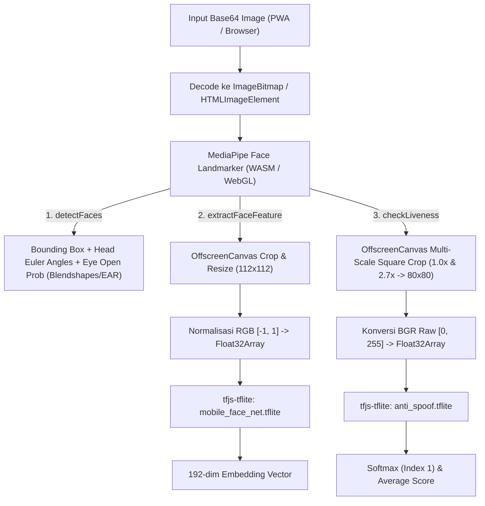
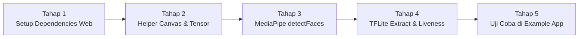

# 🌐 Rencana Implementasi: Dukungan PWA / Web untuk Face Recognition & Anti-Spoofing

Dokumen ini berisi rencana arsitektur dan langkah-langkah teknis untuk mengubah `src/web.ts` dari sekadar *stub/dummy* menjadi **berfungsi penuh di Web / PWA**, dengan tetap menjaga **kompatibilitas 100% dengan Android & iOS**.

---

## 1. Tujuan Utama & Kompatibilitas Lintas Platform

Target utama implementasi PWA ini adalah **Cross-Platform Embedding Compatibility**:
> Wajah yang didaftarkan (*enroll*) di **Android / iOS** harus bisa diverifikasi di **PWA / Web Browser**, begitu pula sebaliknya.

Agar hasil vektor embedding (192 dimensi) identik di semua platform, versi Web **wajib** menggunakan file model `.tflite` dan rumus normalisasi piksel yang sama persis dengan versi Native.

---

## 2. Arsitektur Teknologi Web AI



### Stack Library yang Digunakan:

| Komponen | Library Web | Alasan Pemilihan |
|---|---|---|
| **Face Detection & Landmarks** | `@mediapipe/tasks-vision` (`FaceLandmarker`) | Dikembangkan oleh Google (engine yang sama dengan ML Kit). Mendukung deteksi wajah, rotasi kepala (Euler Y/Z), dan *blendshapes* mata berkedip (`eyeBlinkLeft`, `eyeBlinkRight`). |
| **TFLite Runtime di Browser** | `@tensorflow/tfjs-tflite` + `@tensorflow/tfjs-backend-wasm` | Dapat mengeksekusi file `mobile_face_net.tflite` dan `anti_spoof.tflite` asli secara langsung di browser menggunakan WebAssembly (WASM) + SIMD tanpa perlu melatih ulang model. |
| **Manipulasi Gambar** | `OffscreenCanvas` / HTML5 `<canvas>` | Bawaan browser (0 KB dependency), sangat cepat untuk operasi crop bounding box, resize ($112\times112$ & $80\times80$), dan ekstraksi array RGBA (`getImageData`). |

---

## 3. Rincian Implementasi 4 Fitur Utama di `src/web.ts`

### A. Inisialisasi & Lazy Loading Model (`initModel`)
Karena aplikasi web tidak mem-bundle binary secara statis ke dalam kode JS, plugin akan memuat model secara *lazy* (hanya saat dibutuhkan) dan menyimpannya di memori:
* Path default model dapat dikonfigurasi (misal: `/assets/models/mobile_face_net.tflite` dan `/assets/models/anti_spoof.tflite`).
* Menggunakan akselerasi **WASM SIMD + Multi-threading** agar kecepatan inferensi di browser mendekati native.

### B. `detectFaces` (Deteksi Wajah, Euler Angle & Kedip Mata)
1. Decode Base64 menjadi `HTMLImageElement`.
2. Jalankan `FaceLandmarker.detect(image)` dari MediaPipe.
3. Ekstrak data per wajah:
   - `x, y, width, height`: Dari bounding box wajah yang diklem ke ukuran gambar.
   - `headEulerAngleY` (Yaw / tengok kiri-kanan) & `headEulerAngleZ` (Roll / miring): Dihitung dari matriks transformasi wajah (`facialTransformationMatrixes`) atau koordinat landmark hidung & mata.
   - `leftEyeOpenProbability` & `rightEyeOpenProbability`: Diambil dari skor MediaPipe Face Blendshapes (`1.0 - eyeBlinkLeft` dan `1.0 - eyeBlinkRight`) atau rumus *Eye Aspect Ratio* (EAR) yang sama dengan iOS.

### C. `extractFaceFeature` (Face Recognition 192-dim)
1. Deteksi wajah pertama menggunakan MediaPipe.
2. Crop area wajah menggunakan `<canvas>` dan resize tepat ke **$112 \times 112$ piksel**.
3. Ambil array piksel (`ctx.getImageData(0, 0, 112, 112).data` yang berformat `[R, G, B, A, ...]`).
4. Buang channel Alpha (`A`), lalu masukkan `R, G, B` ke dalam `Float32Array(1 * 112 * 112 * 3)` dengan rumus normalisasi yang identik dengan Android/iOS:
   $$\text{normalized} = \frac{\text{pixel}}{128.0} - 1.0$$
5. Buat tensor `[1, 112, 112, 3]` dan jalankan `tfliteModel.predict(inputTensor)`.
6. Kembalikan output `number[]` sepanjang 192 elemen.

### D. `checkLiveness` (Multi-Scale Anti-Spoofing)
1. Deteksi bounding box wajah, lalu ubah menjadi **bujur sangkar (*square*)** dari titik tengah wajah (`max(width, height)`).
2. Lakukan iterasi untuk 2 scale factor: **`1.0` (crop ketat)** dan **`2.7` (crop lebar)**:
   - Crop gambar pada koordinat bujur sangkar yang telah diperbesar sesuai scale (diklem agar tidak keluar batas gambar).
   - Resize ke **$80 \times 80$ piksel** menggunakan `<canvas>`.
   - Ambil piksel RGBA dari canvas, lalu susun ke dalam `Float32Array(1 * 80 * 80 * 3)` dengan urutan channel **BGR raw `[0, 255]`** (persis seperti `bitmapToByteBufferAntiSpoof` di Android & iOS):
     ```typescript
     float32Data[idx++] = b; // Blue (0 - 255)
     float32Data[idx++] = g; // Green (0 - 255)
     float32Data[idx++] = r; // Red (0 - 255)
     ```
   - Jalankan inferensi pada `anti_spoof.tflite` $\to$ menghasilkan 3 raw logits.
   - Terapkan fungsi **Softmax** dan ambil nilai probabilitas pada **Index 1 (Real Face)**.
3. Rata-ratakan skor dari scale `1.0` dan `2.7`.
4. Bandingkan dengan threshold `0.75` dan tentukan tingkat confidence (`HIGH`, `MEDIUM`, `LOW`).

### E. `compareFaces`
* Sudah terimplementasi di `src/web.ts` saat ini menggunakan Cosine Similarity dan tidak memerlukan perubahan.

---

## 4. Strategi Optimasi untuk PWA (Offline & Cepat)

Agar pengalaman pengguna di PWA setara dengan aplikasi native:

1. **Service Worker / PWA Caching**:
   - Daftarkan file `.tflite` (~10.7 MB total) dan file `.wasm` di dalam konfigurasi **Workbox / Vite PWA plugin** (`globPatterns: ['**/*.{js,css,html,tflite,wasm}']`).
   - Hasilnya: Unduhan model hanya terjadi **1 kali saja** saat pertama kali membuka PWA. Selanjutnya aplikasi dapat berjalan **100% offline**.
2. **Konfigurasi Path Model (`configure` API opsional)**:
   - Menambahkan method opsional `setModelPath({ modelUrl })` atau otomatis membaca dari folder `/assets/models/` di project host web.
3. **Pembersihan Memori (`tf.tidy`)**:
   - Membungkus setiap inferensi tensor dengan `tf.tidy()` atau `tensor.dispose()` agar tidak terjadi *memory leak* (WebGL/WASM out-of-memory) saat kamera melakukan pemindaian berulang kali.

---

## 5. Tahapan Pengerjaan (Milestones)



### Tahap 1: Penambahan Dependencies & Konfigurasi Bundler
- [ ] Tambahkan `@mediapipe/tasks-vision`, `@tensorflow/tfjs-core`, `@tensorflow/tfjs-backend-wasm`, dan `@tensorflow/tfjs-tflite` di `package.json`.
- [ ] Perbarui `rollup.config.mjs` agar dependencies eksternal web di-handle dengan benar.
- [ ] Siapkan script/instruksi penyalinan file `mobile_face_net.tflite` dan `anti_spoof.tflite` ke folder `public/models/` atau `assets/models/` pada aplikasi web/PWA.

### Tahap 2: Pembuatan Image & Canvas Preprocessing (`src/web-utils.ts`)
- [ ] Fungsi `base64ToImage(base64: string): Promise<HTMLImageElement>`.
- [ ] Fungsi `cropAndResize(image, rect, targetSize): ImageData`.
- [ ] Fungsi `imageDataToFloat32RGBNormalized(imageData)` untuk MobileFaceNet (`[-1, 1]`).
- [ ] Fungsi `imageDataToFloat32BGRRaw(imageData)` untuk MiniFASNet (`[0, 255]` BGR).
- [ ] Fungsi `softmax(logits: number[]): number[]`.

### Tahap 3: Implementasi `detectFaces` dengan MediaPipe
- [ ] Inisialisasi `FaceLandmarker` di `src/web.ts`.
- [ ] Ekstraksi bounding box, kalkulasi sudut rotasi kepala (`headEulerAngleY`, `headEulerAngleZ`), dan probabilitas buka/tutup mata (`leftEyeOpenProbability`, `rightEyeOpenProbability`).

### Tahap 4: Implementasi `extractFaceFeature` & `checkLiveness` dengan TFLite Web
- [ ] Load model `mobile_face_net.tflite` & `anti_spoof.tflite` menggunakan `tflite.loadTFLiteModel()`.
- [ ] Implementasi pipeline ekstraksi 192-dim embedding di `extractFaceFeature`.
- [ ] Implementasi pipeline multi-scale ($1.0\times$ & $2.7\times$) anti-spoofing di `checkLiveness`.

### Tahap 5: Integrasi & Pengujian di `example-app` (Vite PWA)
- [ ] Salin model `.tflite` ke `example-app/public/models/`.
- [ ] Buat halaman demo kamera WebRTC (`navigator.mediaDevices.getUserMedia`) di `example-app` untuk menguji Enroll, Verify, Blink Detection, dan Anti-Spoofing langsung di browser Chrome/Safari.

---

## 6. Estimasi Performa & Spesifikasi di Browser

| Metrik | Estimasi Nilai di PWA |
|---|---|
| **Ukuran Download Awal (Model + WASM)** | ~13 MB (di-cache permanen oleh Service Worker PWA) |
| **Waktu `detectFaces` (MediaPipe WASM)** | ~15 – 35 ms per frame |
| **Waktu `extractFaceFeature` (MobileFaceNet)** | ~40 – 90 ms |
| **Waktu `checkLiveness` (2x scale MiniFASNet)** | ~50 – 110 ms |
| **Browser yang Didukung** | Chrome, Edge, Safari (iOS 15.4+ & macOS), Firefox (dengan dukungan WebAssembly SIMD) |

